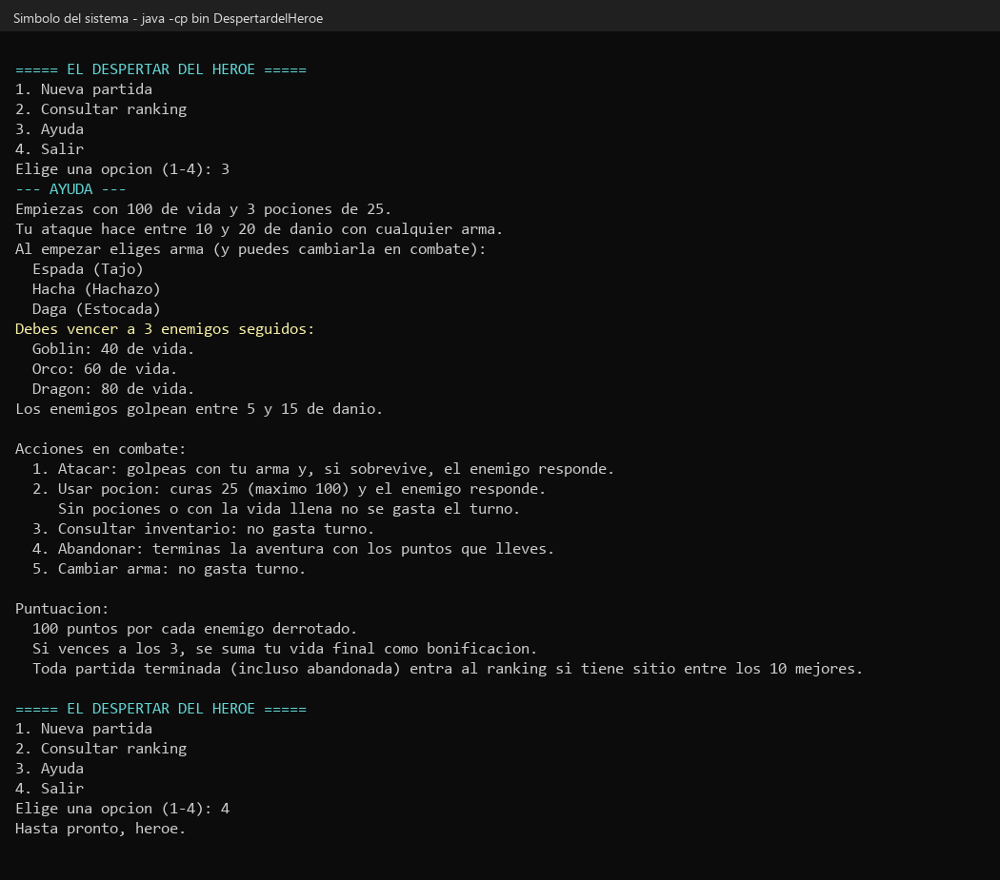
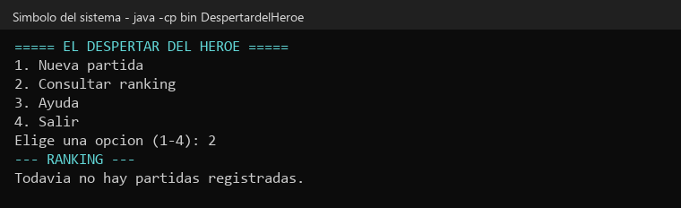
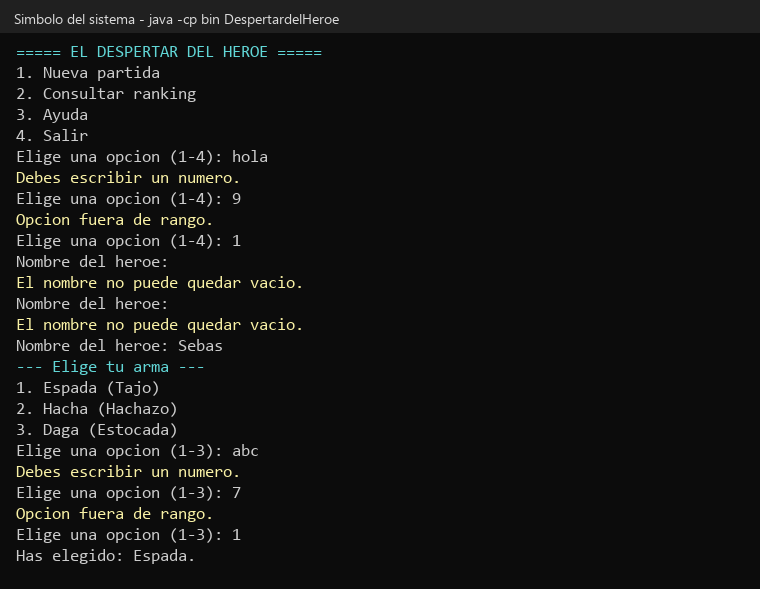
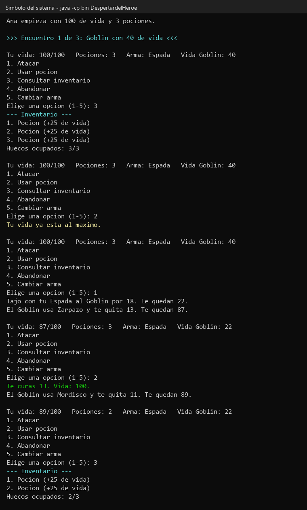
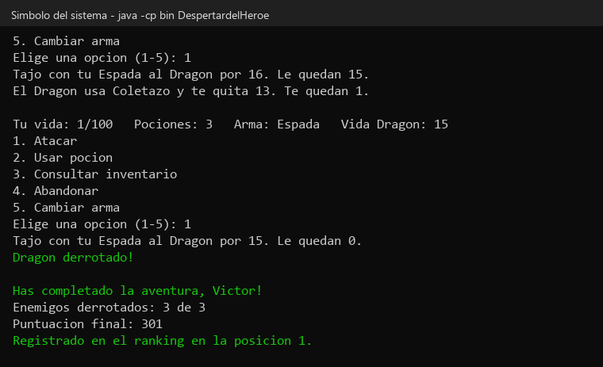
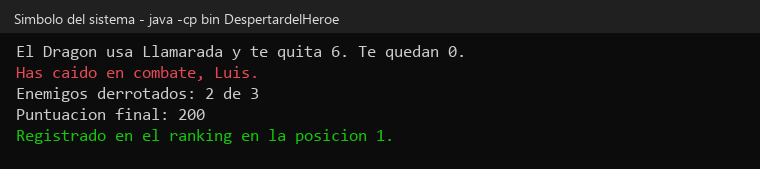
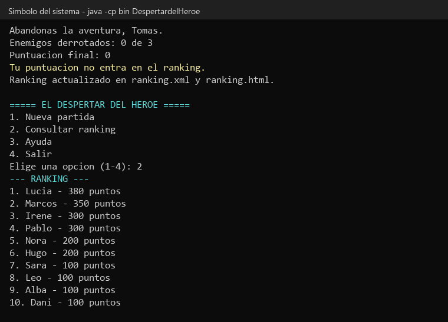
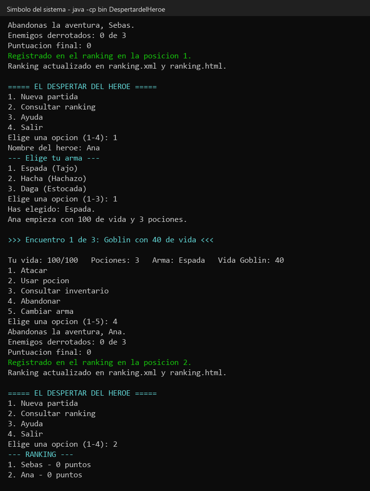
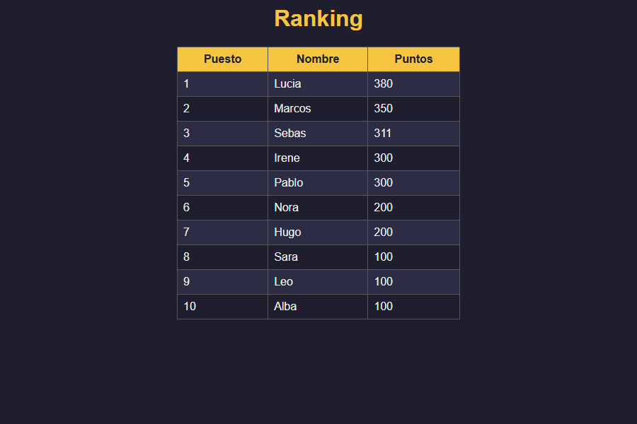
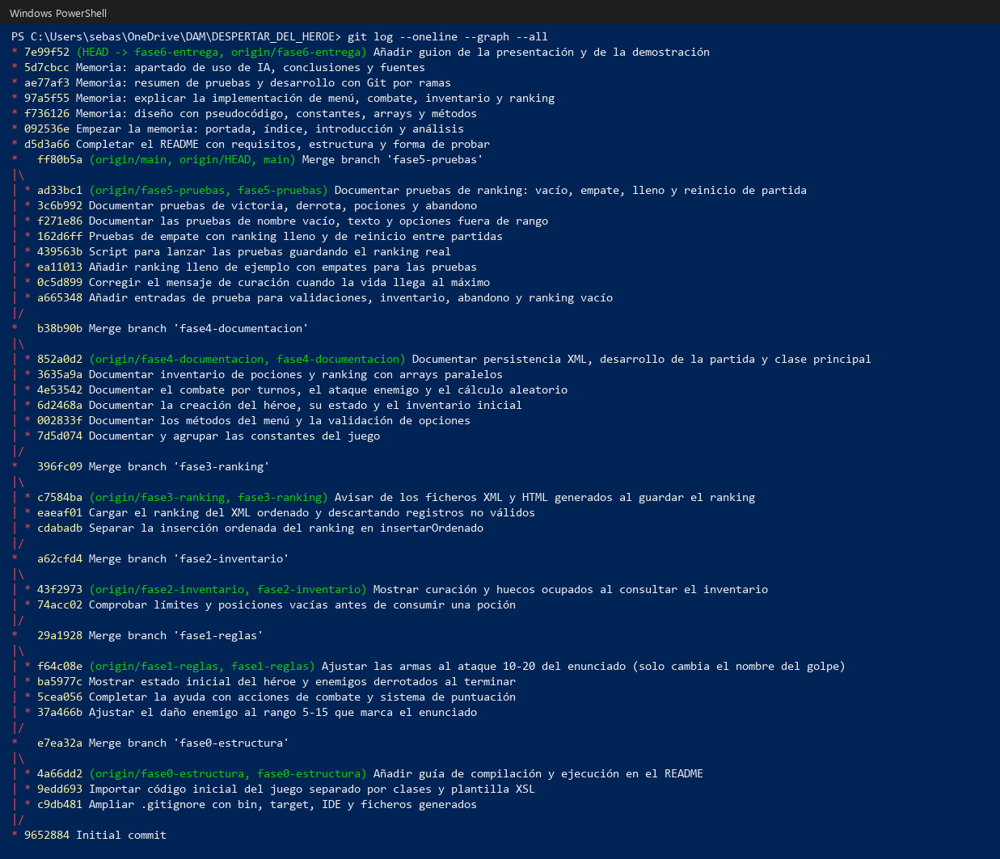

# EL DESPERTAR DEL HÉROE · Aventura textual en Java

**Estudiante:** Sebastian Yanamango Valverde
**Curso:** 1.º DAM · 1.ª evaluación
**Módulos:** Programación, Entornos de desarrollo y Lenguaje de marcas
**Fecha:** noviembre de 2026

> Formato de entrega (PDF): Arial o Times New Roman 12, interlineado 1,5, portada,
> índice y páginas numeradas. Nombre del archivo:
> `DAM_DESPERTAR_HEROE_Yanamango_Valverde_Sebastian_Memoria.pdf`

## Índice

1. Portada e índice
2. Introducción y análisis
3. Diseño de la solución
4. Implementación
5. Pruebas
6. Desarrollo con Git
7. Uso de IA
8. Conclusiones y recursos

---

## 2. Introducción y análisis

### El encargo

Un estudio de videojuegos quiere un prototipo de "El despertar del héroe" antes de
seguir desarrollándolo. Es un juego por turnos en consola en el que el jugador crea
un héroe y tiene que superar tres combates seguidos contra enemigos cada vez más
fuertes. La aventura acaba al vencer al tercero, al quedarse sin vida o al abandonar.

### Reglas

- El héroe empieza con 100 de vida y 3 pociones que curan 25.
- El ataque del héroe hace entre 10 y 20 de daño.
- Los enemigos tienen 40, 60 y 80 de vida y hacen entre 5 y 15 de daño.
- La vida nunca baja de 0 ni sube de 100 al curarse.
- Cada enemigo derrotado da 100 puntos. Si se gana la aventura se suma la vida final.
- Toda partida terminada, también abandonada, se intenta meter en el ranking.
- El ranking tiene 10 puestos, ordenado de mayor a menor, y se guarda en XML.

### Alcance

Una aplicación de consola con métodos `static`, tipos básicos y arrays de tamaño
fijo. No se usan clases de dominio, herencia, `ArrayList` ni excepciones propias.
El ranking y el inventario se guardan en ficheros XML y el ranking además se puede
ver en una página HTML generada con XSLT (parte de Lenguaje de marcas).

### Ampliaciones propias

- **Armas:** al empezar se elige espada, hacha o daga. Todas hacen 10-20 como pide
  el enunciado; cambia el nombre del arma y del golpe (tajo, hachazo, estocada).
  Se puede cambiar de arma en combate sin gastar turno.
- **Ataques con nombre:** cada enemigo tiene tres ataques y usa uno al azar.
- **ranking.html:** página con la tabla del ranking generada con `ranking.xsl`.

### Necesidades del jugador

- Saber en todo momento su vida, sus pociones, su arma y la vida del enemigo.
- Que un error al escribir no cierre el juego ni le haga perder el turno.
- Poder consultar las reglas (Ayuda) y el ranking desde el menú.

---

## 3. Diseño de la solución

### Pseudocódigo general

```
cargar ranking desde ranking.xml
HACER
    mostrar menu
    leer opcion valida entre 1 y 4
    SEGUN opcion
        1: iniciarPartida
        2: mostrarRanking
        3: mostrarAyuda
        4: despedirse
MIENTRAS opcion != 4

iniciarPartida:
    leer nombre (no vacio), elegir arma
    crear estado {100, 3, arma} e inventario con 3 pociones
    enemigo = 0, resultado = VICTORIA, puntos = 0
    MIENTRAS enemigo < 3 Y resultado == VICTORIA
        resultado = simularCombate(enemigo)
        SI resultado == VICTORIA: puntos += 100, enemigo++
    SI resultado == VICTORIA: puntos += vida
    registrar en ranking, guardar XML y generar HTML

simularCombate:
    MIENTRAS no haya resultado
        mostrar estado y acciones, leer accion
        1 atacar: daño aleatorio; SI el enemigo sigue vivo, ataca
        2 pocion: SI se ha podido beber, el enemigo ataca
        3 inventario / 5 cambiar arma: no gastan turno
        4 abandonar
        comprobar si el enemigo o el heroe han llegado a 0
```

### Constantes

Todas están en `Constantes.java` para no tener números sueltos por el código:
`VIDA_MAXIMA = 100`, `POCIONES_INICIALES = 3`, `CURACION_POCION = 25`,
`VIDA_ENEMIGOS = {40, 60, 80}`, `DANIO_ENEMIGO_MIN = 5`, `DANIO_ENEMIGO_MAX = 15`,
`PUNTOS_POR_ENEMIGO = 100`, `CAPACIDAD_INVENTARIO = 3`, `CAPACIDAD_RANKING = 10`,
`ATAQUE_MIN = 10`, `ATAQUE_MAX = 20`, los nombres de las armas, los nombres de los ficheros, las posiciones del array del
héroe (`VIDA`, `POCIONES`, `ARMA`) y los resultados de un combate
(`SIN_RESOLVER`, `DERROTA`, `VICTORIA`, `ABANDONO`).

### Variables y arrays principales

| Nombre | Tipo | Para qué sirve |
|--------|------|----------------|
| `estadoHeroe` | `int[3]` | Vida, pociones que quedan y arma elegida |
| `inventario` | `String[3]` | Las pociones; el contador es `estadoHeroe[POCIONES]` |
| `nombresRanking` | `String[10]` | Nombres del ranking |
| `puntosRanking` | `int[10]` | Puntos del ranking (misma posición = mismo jugador) |
| `numRegistros` | `int` | Cuántos puestos del ranking están ocupados |
| `vidaEnemigo` | `int` | Vida del enemigo durante su combate |
| `puntos` | `int` | Puntuación de la partida |
| `resultado` | `int` | Cómo ha acabado el combate |

### Métodos

| Clase | Método | Qué hace | Devuelve |
|-------|--------|----------|----------|
| DespertardelHeroe | `main` | Carga datos y lleva el menú | - |
| Menu | `mostrarMenu`, `mostrarAyuda` | Muestran texto | - |
| Menu | `leerOpcion(scanner, min, max)` | Lee un número válido | opción |
| Heroe | `leerNombre(scanner)` | Lee un nombre no vacío | nombre |
| Heroe | `elegirArma(scanner)` | Menú de armas | posición del arma |
| Heroe | `crearEstado(arma)`, `crearInventario()` | Datos iniciales | arrays nuevos |
| Partida | `iniciarPartida(...)` | Tres combates y puntuación | `numRegistros` |
| Combate | `simularCombate(...)` | Un combate por turnos | resultado |
| Combate | `numeroAleatorio(min, max)` | Número con `Math.random()` | número |
| Enemigo | `atacar(...)` | Quita vida al héroe | - |
| Pocima | `usarPocion(...)` | Bebe una poción si se puede | si gasta turno |
| Pocima | `mostrarInventario(...)` | Recorre las posiciones ocupadas | - |
| Ranking | `registrarEnRanking(...)` | Mete la partida y avisa | `numRegistros` |
| Ranking | `insertarOrdenado(...)` | Inserta desplazando | posición o -1 |
| Ranking | `mostrarRanking(...)` | Lista o mensaje de vacío | - |
| PersistenciaXml | `guardarRanking`, `cargarRanking`, `guardarInventario`, `cargarInventario`, `generarHtmlRanking`, `escribirXml` | Ficheros XML y HTML | según el método |

### Paso de parámetros: primitivos y arrays

Los `int` se pasan por copia: si `registrarEnRanking` hace `numRegistros++`, fuera
no cambia nada. Por eso devuelve el nuevo valor y en `main` se hace
`numRegistros = Partida.iniciarPartida(...)`.

Los arrays se pasan por referencia (se copia la dirección del array, no su
contenido). Por eso la vida y las pociones del héroe están en `int[] estadoHeroe`:
cuando `Enemigo.atacar` cambia `estadoHeroe[VIDA]`, el cambio se ve en el combate y
en la partida. Lo mismo pasa con los arrays del ranking y del inventario.

---

## 4. Implementación

### Menú

`main` usa un `do-while` con `switch` para que el menú salga al menos una vez y
vuelva a salir después de cada partida, hasta elegir 4. Todas las opciones se leen
con `Menu.leerOpcion`, que usa `hasNextInt()`: si no es un número descarta la línea
entera con `nextLine()` y vuelve a preguntar; si es un número fuera de rango
también. Después de `nextInt()` hay un `nextLine()` para quitar el salto de línea,
porque si no el `nextLine()` del nombre lo leería vacío.

### Combate

`simularCombate` tiene un `while` que sigue mientras el resultado sea
`SIN_RESOLVER`. Atacar resta el daño a la vida del enemigo con `Math.max(0, ...)`
para que no sea negativa, y solo si el enemigo sigue vivo llama a `Enemigo.atacar`.
Usar poción solo provoca el ataque si `usarPocion` devuelve `true`. Consultar el
inventario y cambiar de arma no hacen atacar al enemigo. Una opción no válida ni
siquiera llega al `switch` porque `leerOpcion` no la deja pasar.

El daño sale de `numeroAleatorio(min, max) = min + (int)(Math.random() * (max - min + 1))`.
Por ejemplo, para 10-20: `Math.random() * 11` da de 0 a 10,99..., al pasarlo a
`int` queda de 0 a 10 y al sumar 10 queda de 10 a 20, los dos incluidos.

### Inventario

Es un `String[3]` y el contador de pociones (`estadoHeroe[POCIONES]`) dice cuántas
posiciones están ocupadas, siempre las primeras. Al mostrarlo se recorre hasta el
contador, no hasta `length`, para no enseñar huecos vacíos. Al beber se vacía la
posición `contador - 1` (la última ocupada) y se resta 1 al contador; antes se
comprueba que esa posición está dentro del array y no es `null`.

### Puntuación

En `iniciarPartida` se suman 100 puntos cada vez que `simularCombate` devuelve
`VICTORIA`. Solo si se ganan los tres combates se suma `estadoHeroe[VIDA]`. Da igual
cómo acabe la partida: siempre se llama a `registrarEnRanking`.

### Ranking

Dos arrays paralelos de 10 posiciones. `insertarOrdenado` busca la posición
avanzando mientras la puntuación nueva **no** sea mayor que la de esa posición
(`!(puntosNuevos > puntos[posicion])`); así, en un empate el nuevo queda detrás del
antiguo. Luego desplaza los de detrás una posición hacia el final, moviendo nombre
y puntos a la vez para que no se desordenen. Si el ranking está lleno solo entra si
es mayor que el décimo, y el décimo se pierde.

### Ficheros XML y HTML

Al terminar cada partida se guarda `ranking.xml` y `inventario.xml` con DOM y se
genera `ranking.html` con `ranking.xsl`. Al arrancar se carga `ranking.xml`
metiendo cada jugador con `insertarOrdenado`, así aunque alguien edite el XML a mano
el ranking sigue ordenado y con máximo 10. El inventario guardado solo se muestra
como información, porque cada partida nueva tiene que empezar con 3 pociones.

### Decisiones

- Separar el código en varias clases con métodos `static` para que cada fichero sea
  corto y sea más fácil encontrar cada parte. Siguen sin ser clases de dominio (no
  se crean objetos `Heroe` ni `Enemigo`), solo agrupan métodos.
- No usar variables globales que cambien: todo lo que cambia se pasa por parámetro.
- `estadoHeroe` como array para poder modificarlo desde otros métodos.

---

## 5. Pruebas

La tabla completa (entrada, resultado esperado y obtenido) está en `PRUEBAS.md`.
Se probaron 16 casos: nombre vacío, texto en vez de número, opción fuera de rango,
victoria, derrota, pociones (con vida llena y con vida baja), consultar inventario,
abandono, ranking vacío, ranking entre ejecuciones, empate, ranking lleno (no entra,
empata con el décimo y entra), reinicio entre partidas y el HTML.

Las entradas se guardaron en `pruebas/entradas` para poder repetirlas con
`pruebas\ejecutar_pruebas.bat`. Como el daño es aleatorio, en el combate se
comprobó que los golpes estén en su rango y que se cumplan las reglas.

**Figura 1**

*Menú principal y ayuda con reglas, acciones y puntuación*



*Nota.* La ayuda saca los valores de Constantes, así que si cambia una regla la ayuda cambia sola.

**Figura 2**

*Consulta del ranking sin partidas guardadas*



*Nota.* Sin ranking.xml el programa muestra un mensaje informativo en lugar de una lista vacía.

**Figura 3**

*Validación de texto, opciones fuera de rango y nombre vacío*



*Nota.* Ninguna entrada incorrecta cierra el programa; se avisa y se vuelve a preguntar.

**Figura 4**

*Consulta del inventario y uso de pociones en combate*



*Nota.* Con la vida llena la poción no se gasta y el enemigo no ataca. Con 89 de vida se curan 11 (no 25, porque el máximo es 100) y el enemigo responde. El inventario pasa de 3/3 a 2/3.

**Figura 5**

*Final de una partida ganada*



*Nota.* Puntuación = 3 × 100 + vida final. El enemigo derrotado ya no ataca.

**Figura 6**

*Partida perdida*



*Nota.* La vida se queda en 0 y no es negativa. No hay bonificación por vida.

**Figura 7**

*Ranking lleno con una puntuación que no entra*



*Nota.* Con 10 registros solo entra una puntuación mayor que la décima (100).

**Figura 8**

*Empate entre dos partidas con la misma puntuación*



*Nota.* Sebas jugó antes que Ana y por eso queda delante con los mismos puntos.

**Figura 9**

*Ranking generado en HTML con la plantilla ranking.xsl*



*Nota.* Sebas ha ganado con 311 puntos y ha entrado en el puesto 3; Dani (décimo) ha salido.

**Error encontrado:** al curarse con 89 de vida el mensaje decía "Te curas 25"
pero la vida solo llegaba a 100. Se corrigió calculando lo curado de verdad.

---

## 6. Desarrollo con Git

Repositorio: https://github.com/sebaaas0705/Despertar-del-Heroe

Se trabajó con una rama por fase y al acabar cada una se unió a `main` con merge:

| Rama | Qué se hizo |
|------|-------------|
| `fase0-estructura` | `.gitignore` (bin, target, IDE, ficheros generados), código inicial y README |
| `fase1-reglas` | Daño enemigo 5-15 como pide el enunciado y ayuda completa |
| `fase2-inventario` | Comprobar límites del array al gastar poción y mejorar la consulta |
| `fase3-ranking` | Separar `insertarOrdenado` y cargar el XML ordenado |
| `fase4-documentacion` | Comentarios Javadoc con finalidad, parámetros y retorno |
| `fase5-pruebas` | Entradas de prueba, script y tabla de pruebas |
| `fase6-entrega` | README final, memoria y presentación |

Commits representativos:

- *Ajustar el daño enemigo al rango 5-15 que marca el enunciado*: al revisar las
  reglas vi que tenía 7-17 y lo cambié en `Constantes`, sin tocar nada más.
- *Separar la inserción ordenada del ranking en insertarOrdenado*: así el mismo
  método sirve para registrar una partida y para cargar el XML.
- *Corregir el mensaje de curación cuando la vida llega al máximo*: error que salió
  haciendo las pruebas.

**Figura 10**

*Historial del repositorio con las ramas de cada fase*



*Nota.* Salida de `git log --oneline --graph --all`. Cada rama se une a `main` con un merge.

---

## 7. Uso de IA

*(Obligatorio según el apartado 10 del enunciado. Rellenar con lo que se haya usado
de verdad, o declarar expresamente que no se ha usado.)*

- **Herramienta(s):**
- **Para qué tareas:**
- **Ejemplos de instrucciones (prompts):**
- **Qué se incorporó y qué se cambió:**
- **Cómo se comprobó (pruebas, revisión del código, explicación de cada método):**

---

## 8. Conclusiones y recursos

### Resultados

El juego cumple las reglas comunes: menú con `do-while` y `switch`, tres combates
con `while`, pociones con array fijo y contador, ranking de 10 con arrays paralelos
ordenado y con empates, validación de todas las entradas y guardado en XML. Además
tiene armas, ataques con nombre y el ranking en HTML.

### Dificultades

- Entender por qué un `int` modificado dentro de un método no cambia fuera y por
  qué con un array sí.
- El salto de línea que deja `nextInt()` en el `Scanner`.
- Desplazar los dos arrays del ranking a la vez sin perder ningún registro, sobre
  todo con el ranking lleno.
- Leer y escribir XML con DOM y aplicar la plantilla XSL.

### Aprendizajes

Dividir el programa en métodos pequeños que reciben lo que necesitan hace que sea
más fácil probar cada parte y encontrar los fallos. Trabajar con ramas en Git
ayuda a tener cada cambio separado.

### Mejoras posibles

- Guardar también la fecha de cada partida en el ranking.
- Más enemigos o niveles de dificultad.
- Un objeto que se pueda encontrar al ganar un combate.

### Referencias

Chacon, S. y Straub, B. (2014). *Pro Git* (2.ª ed.). Apress. https://git-scm.com/book/es/v2

Oracle. (2023). *Class Math* (Java SE 21 & JDK 21). https://docs.oracle.com/en/java/javase/21/docs/api/java.base/java/lang/Math.html

Oracle. (2023). *Class Scanner* (Java SE 21 & JDK 21). https://docs.oracle.com/en/java/javase/21/docs/api/java.base/java/util/Scanner.html

Oracle. (2023). *Package javax.xml.transform* (Java SE 21 & JDK 21). https://docs.oracle.com/en/java/javase/21/docs/api/java.xml/javax/xml/transform/package-summary.html

World Wide Web Consortium. (1999). *XSL Transformations (XSLT) Version 1.0*. https://www.w3.org/TR/xslt-10/

XTART Formación Profesional. (2026). *El despertar del héroe: Aventura textual en Java* [Enunciado del proyecto, 1.º DAM].
